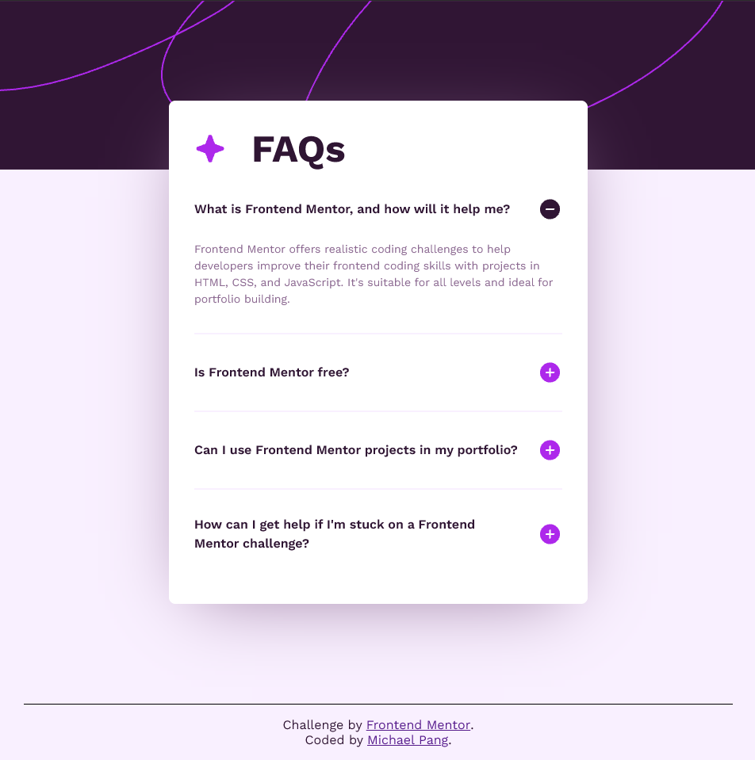

# Frontend Mentor - FAQ accordion solution

This is a solution to the [FAQ accordion challenge on Frontend Mentor](https://www.frontendmentor.io/challenges/faq-accordion-wyfFdeBwBz). Frontend Mentor challenges help you improve your coding skills by building realistic projects. 

## Table of contents

- [Frontend Mentor - FAQ accordion solution](#frontend-mentor---faq-accordion-solution)
  - [Table of contents](#table-of-contents)
  - [Overview](#overview)
    - [The challenge](#the-challenge)
    - [Screenshot](#screenshot)
    - [Links](#links)
  - [My process](#my-process)
    - [Built with](#built-with)
    - [What I learned](#what-i-learned)
    - [Continued development](#continued-development)
  - [Author](#author)

## Overview

### The challenge

Users should be able to:

- Hide/Show the answer to a question when the question is clicked
- Navigate the questions and hide/show answers using keyboard navigation alone
- View the optimal layout for the interface depending on their device's screen size
- See hover and focus states for all interactive elements on the page

### Screenshot



### Links

- Solution URL: [https://github.com/pangm1/FrontEndMentor-FAQ-Accordion_pangm1](https://github.com/pangm1/FrontEndMentor-FAQ-Accordion_pangm1)
- Live Site URL: [https://front-end-mentor-faq-accordion-pang.vercel.app](https://front-end-mentor-faq-accordion-pang.vercel.app)

## My process

### Built with

- Semantic HTML5 markup
- CSS custom properties
- Flexbox
- Mobile-first workflow
- WAI-ARIA

### What I learned

I learned how to markdown and style the ```details``` and ```summary``` html elements. I also learned how to navigate a website using the NVDA screenreader, and what various elements in the website structure is read out as. I thought that I would have to elaborate on the role of the buttons, but the states of ```details``` are read aloud. I learned how to make an element's label read out in the screenreader but be invisible to sighted users. I also styled the ```:before``` and ```:after``` pseudo-elements so that it would act like icons that I could size dynamically (for the most part). I got rid of the markers for the summary elements, and instead used the :after pseudo-element because I didn't know how to style them.

### Continued development

Hopefully, when the projects get more complex and include dynamic elements and dynamically-generated content, I could learn how to use WAI-ARIA, CSS, and Javascript to allow screenreaders and keyboard users to be able to use the information on the website.

## Author

- Frontend Mentor - [@pangm1](https://www.frontendmentor.io/profile/pangm1)
